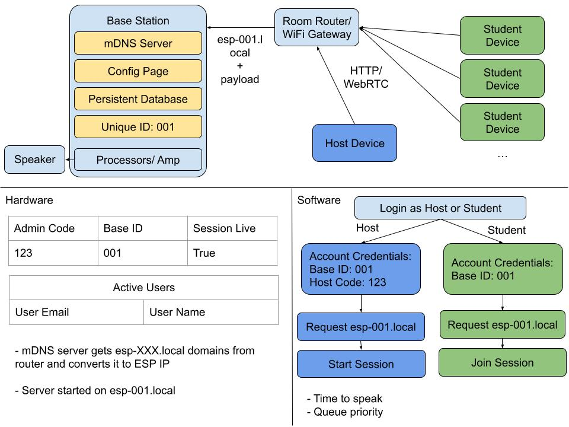
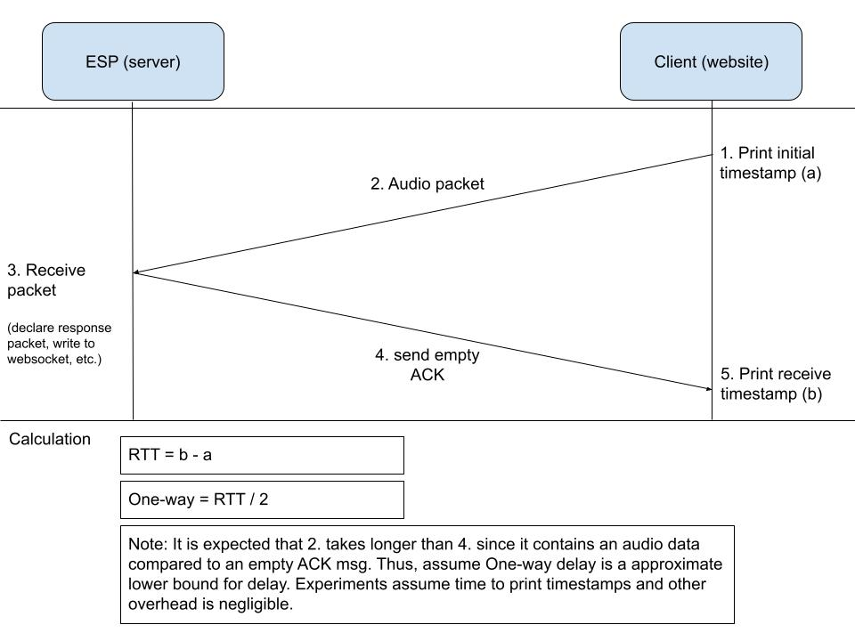
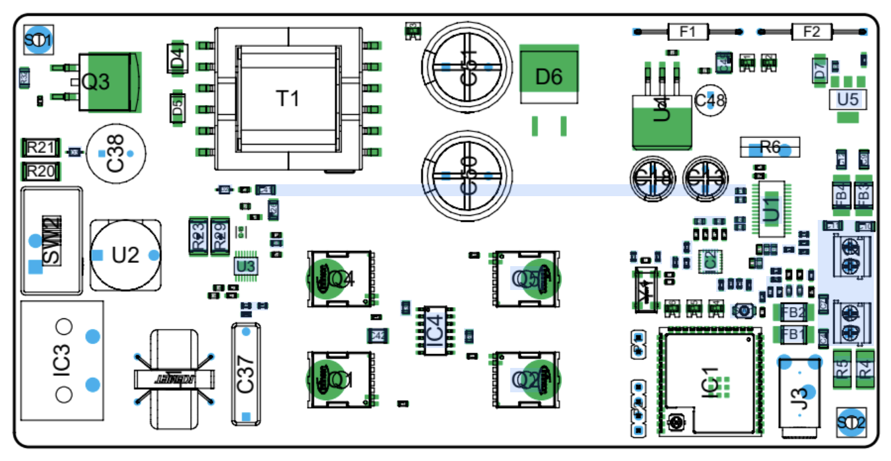
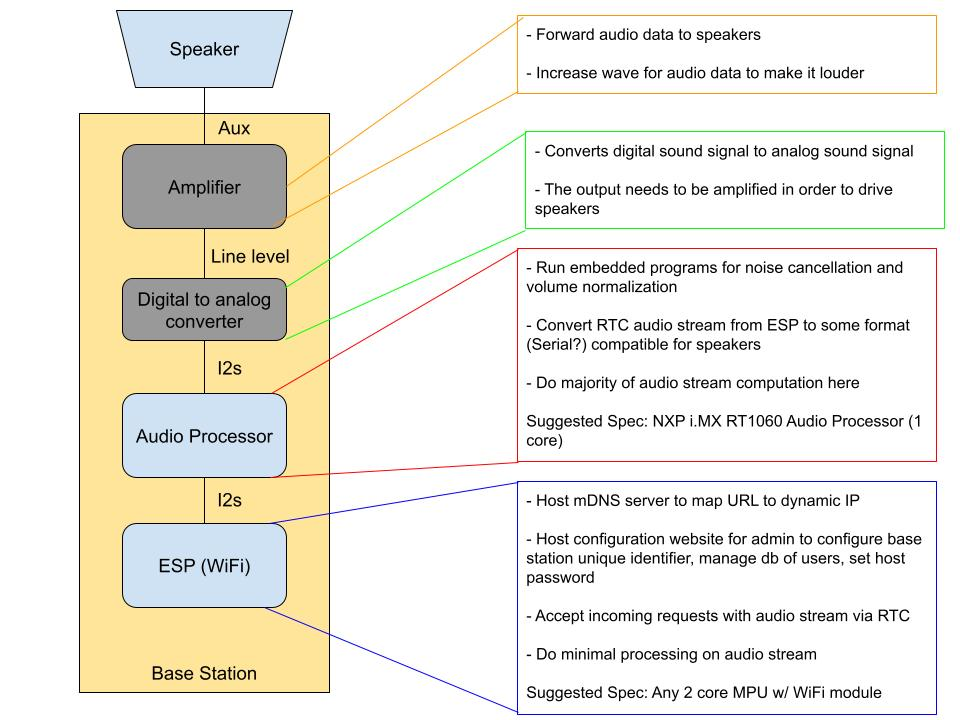

# vocast base station embedded program 

embedded files on vocast Arduino base station. base station is a PCB comprised of esp, amp, and aux out port (further details in diagrams below).

## demo
demo of product working end-to-end: [link](https://drive.google.com/file/d/1o-KAi-wnZ30kQOHBn8sMmy-xl_gA8gt-/view?usp=sharing)

## full system communication

## network experiment

## pcb diagram

## hardware requirements

